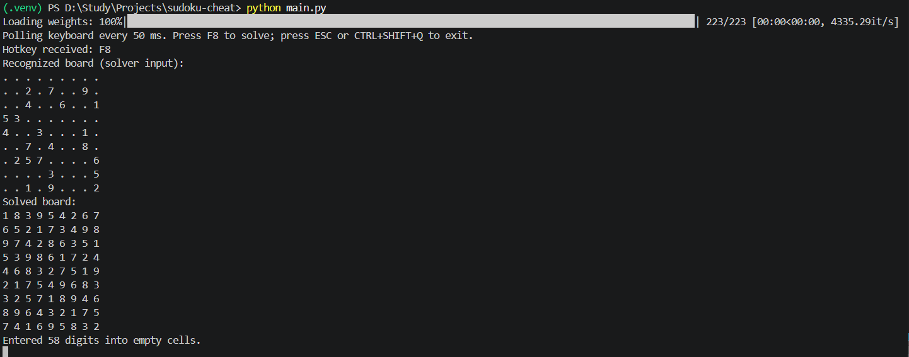
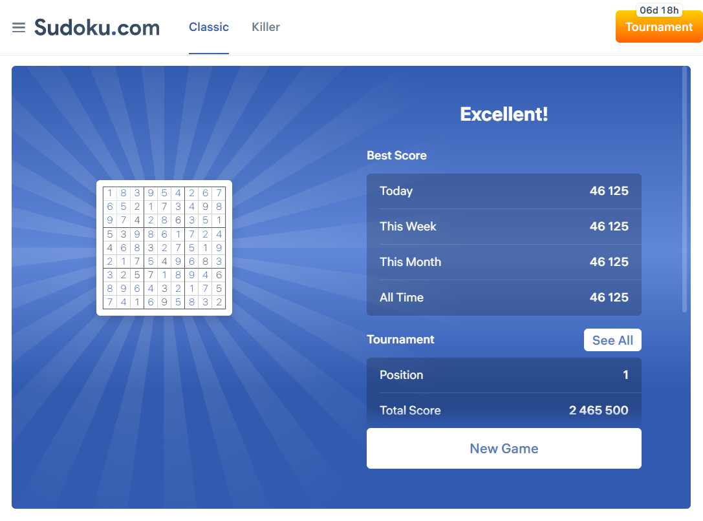

# Sudoku-Cheat

## About

This project was made mostly for fun. A long time ago, I solved a LeetCode problem about Sudoku solving using a backtracking algorithm, and I decided to turn it into something a little more interesting.

The idea is simple: take a screenshot of a Sudoku board, recognize the digits, solve the puzzle, and enter the missing numbers back into the game automatically.

For digit recognition, I trained a classifier based on the DINOv2 Vision Transformer. Obviously, we don't really need a neural network to recognize digits from a Sudoku screenshot, but where is the fun in that?

I started with the MNIST dataset and then fine-tuned the model on data captured directly from the Sudoku website, since the digits in the actual game look a little different from handwritten MNIST digits.

The project combines a DINOv2-based digit classifier, a backtracking Sudoku solver, screen capture, and keyboard/mouse automation.

If you somehow find this project useful (I honestly doubt it), keep in mind that you need to manually specify the pixel coordinates of the top-left and bottom-right corners of the Sudoku board. The program does not detect the board automatically.

The model checkpoint is not included in the repository, so you'll need to provide it yourself. I might upload the trained weights at some point, but no promises.

## Short demo screenshots

| Recognized and solved board | Completed game |
| --- | --- |
|  |  |

## How it works

1. Capture the part of the screen containing the Sudoku board.
2. Split the board into 81 cells and detect empty ones.
3. Use the fine-tuned DINOv2 model to classify each cell as a digit from 0 to 9. Here, `0` means an empty cell.
4. Solve the puzzle using a classic backtracking algorithm.
5. Click the empty cells and type in the missing digits.

## Requirements

- Windows
- Python
- Dependencies from `requirements.txt`
- A compatible model checkpoint at `models/v5/model.pth`
- A visible, axis-aligned 9×9 Sudoku board

## Setup

Clone the repository and install the dependencies:

```powershell
py -m venv .venv
.\.venv\Scripts\Activate.ps1
python -m pip install -r requirements.txt
```

If PowerShell refuses to activate the virtual environment, you can use its Python executable directly:

```powershell
.\.venv\Scripts\python.exe -m pip install -r requirements.txt
```

## Run

Start the application from the repository root:

```powershell
python main.py
```

- `F8` — capture the board, solve it, and enter the solution.
- `Esc` or `Ctrl+Shift+Q` — exit the application.

Before running it, configure the board coordinates in `utils/sudoku_interactor.py`:

- `BOARD_TOP_LEFT`
- `BOARD_BOTTOM_RIGHT`

These are absolute screen coordinates, so the game window needs to stay in the same position. If you move the window or change the browser zoom, you'll probably need to update them.

Also, make sure the correct game window is focused before pressing `F8`. The program will type numbers wherever it thinks the Sudoku cells are, and it won't ask for permission first.

## Training

The training script uses `torchvision.datasets.ImageFolder` with the following directory structure:

```text
data/
└── dataset/
    ├── train/
    │   ├── 0/
    │   ├── 1/
    │   └── ... 9/
    └── val/
        ├── 0/
        ├── 1/
        └── ... 9/
```

To train or fine-tune the model, run:

```powershell
python -m train.main
```

The current configuration loads `models/v3/model.pth`, fine-tunes the final DINOv2 encoder layer and the classifier head, and saves the resulting checkpoint to `models/v5/model.pth`.

The training pipeline uses weighted sampling to deal with class imbalance. Validation uses the original class distribution and reports precision, recall, F1-score, and support for each class.

## Collecting data

You can capture Sudoku cells and label them manually:

```powershell
python capture_sudoku_cells.py --capture-and-label
```

The program waits for `F8` before capturing the board. Empty cells are automatically labeled as `0` and skipped during manual labeling by default.

If you want to label every cell yourself:

```powershell
python capture_sudoku_cells.py --capture-and-label --no-auto-empty
```

Other available modes:

```powershell
# Capture a board without labeling it
python capture_sudoku_cells.py --capture-only

# Label an existing capture
python capture_sudoku_cells.py --label-dir "data\sudoku_debug\<capture-folder>"

# Save labeled cells to the training split
python capture_sudoku_cells.py --capture-and-label --dataset-root "data\dataset\train"
```

Try to keep data from the same board or capture session in a single split. Otherwise, nearly identical cells can end up in both training and validation, making the evaluation look better than it actually is.

## Limitations

- Only classic 9×9 Sudoku is supported.
- Board coordinates must be configured manually.
- The model's accuracy depends on the quality of the checkpoint and how closely the game digits resemble the training data.
- The board must be axis-aligned; automatic perspective correction is not implemented.
- The application enters digits automatically without asking for confirmation.

That's pretty much it. A Sudoku solver, a Vision Transformer, and a questionable decision to combine them into one project.

May be in the future I will try to train model on some datasets for the sudoku solving. Or may be not